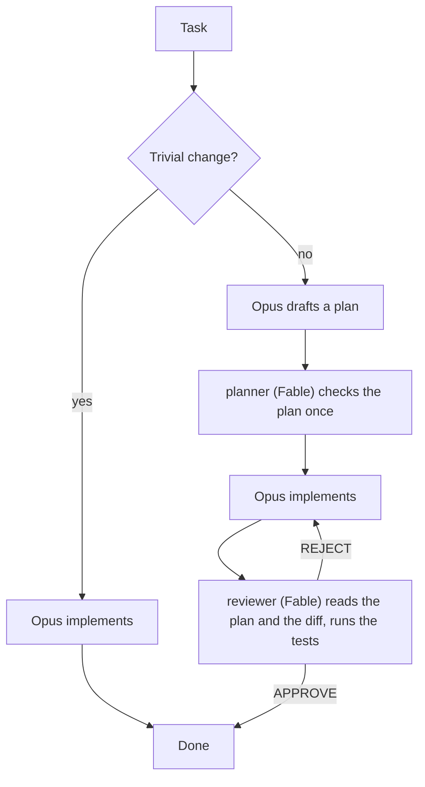

# Claude Code multi-model workflow

A small Claude Code configuration that gives each part of a coding task to the model suited to it: Sonnet searches the codebase, Opus writes the code, and Fable checks the plan and reviews the result in fresh context.

It consists of three subagent definitions, a short `CLAUDE.md` section and one settings file. Nothing is installed and no code runs in your project.

## How it works



The main session runs on Opus and does the work. It hands specific steps to three subagents, each of which starts with an empty context and returns only its conclusion:

| Agent | Model | Tools | When it runs |
|---|---|---|---|
| `search` | Sonnet, medium effort | Read, Glob, Grep | Broad searches: more than about three queries, or several files to read |
| `planner` | Fable | Read, Glob, Grep, Bash | Once, before a plan for a non-trivial change is locked |
| `reviewer` | Fable, extra-high effort | Read, Grep, Glob, Bash | Before non-trivial work is called done, and after the same error has occurred twice |

A change counts as trivial when it touches one file, is under about 30 lines, and does not change behaviour or interfaces. Trivial changes skip the planner and the reviewer.

The reasoning behind each rule, and token measurements from a test run, are in [docs/design.md](docs/design.md).

## What is in the repository

| Path | Purpose |
|---|---|
| `.claude/agents/search.md` | The search subagent |
| `.claude/agents/planner.md` | The planner subagent |
| `.claude/agents/reviewer.md` | The reviewer subagent |
| `.claude/settings.json` | Sets the main session model to Opus for the project |
| `CLAUDE.md` | The rules that tell the main session when to use each agent |
| `.claude/models.py` | Optional script that shows which model each agent used and how many tokens it consumed |
| `.claude/solo.sh` | Optional script that runs a session on one model with subagents disabled |

## Requirements

- Claude Code. The setup was built and tested on version 2.1.319; it relies on the `fable` model alias and the `effort` field in subagent frontmatter.
- An account with access to Sonnet, Opus and Fable. Without Fable access, set `model: opus` in `planner.md` and `reviewer.md`.
- A git repository in your project. The reviewer reads the change with `git diff`.
- Python 3, only for the optional usage script.

## Install in a project

Clone this repository, then run the following from the root of your own project, replacing `<clone>` with the path to the clone:

```sh
mkdir -p .claude/agents
cp <clone>/.claude/agents/*.md .claude/agents/
cp <clone>/.claude/models.py .claude/
cp <clone>/.claude/solo.sh .claude/
cat <clone>/CLAUDE.md >> CLAUDE.md
```

Then set the main model. If your project has no `.claude/settings.json`, copy the one from this repository. If it has one, add this key to it:

```json
{
  "model": "opus"
}
```

Restart Claude Code in the project. Subagents and settings are loaded when a session starts, so a running session will not see the new files.

To use the workflow in every project, put the agent files in `~/.claude/agents/`, the rules in `~/.claude/CLAUDE.md`, and the model setting in `~/.claude/settings.json`. To run `solo.sh` from anywhere, copy it to a directory on your `PATH`.

## Check that it works

After restarting, the startup banner should say the model comes from `.claude/settings.json`, and `/agents` should list `search`, `planner` and `reviewer`.

For an end-to-end check, give Claude a small task that touches several files, then run the usage script from the project root:

```sh
python3 .claude/models.py
```

A working setup prints one line per agent with the model it ran on:

```
session e4381898
  main       claude-opus-5-5       12 req    581,253 in (95% cached)    5,183 out
  planner    claude-fable-5-1       2 req     12,867 in (43% cached)    4,055 out
  reviewer   claude-fable-5-1       3 req     23,123 in (72% cached)    1,945 out
  search     claude-sonnet-5-5      2 req     11,843 in (44% cached)      657 out
```

[docs/testing.md](docs/testing.md) has the full walk-through: the test prompts, what to expect from each, and what to do when a step does not behave as described.

## Customise

- **The trivial-change threshold** is one line in `CLAUDE.md`. Raise it if the reviewer runs on changes you consider routine; lower it if unreviewed changes cause problems.
- **Models** are the `model:` line in each agent file. Accepted values are `sonnet`, `opus`, `haiku`, `fable`, a full model ID, or `inherit`.
- **Effort** is the `effort:` line. The reviewer is set to `xhigh` because a missed bug is the most expensive failure in this workflow and the reviewer's runs are short. If your model does not accept `xhigh`, use `high`.
- **Test commands.** Add your project's test, lint and type-check commands to `CLAUDE.md`. The main session and the reviewer both read that file, and a reviewer that can run the tests catches more than one that only reads the diff.

## Run on a single model

The workflow can be switched off for one session without changing any files. From the project root:

```sh
.claude/solo.sh fable
```

This starts a session where Fable does everything. With no arguments it uses Opus. Anything after the model name goes to `claude`, so `.claude/solo.sh sonnet -p "fix the failing test"` also works. The model name is required when other arguments follow, because the first argument is always read as the model.

`--disallowedTools` removes the tool that starts subagents, and the appended prompt stops the model following rules it can no longer carry out. `/agents` still lists the agents, but the session cannot start them. Use `--model` rather than `/model` for this, because `/model` saves the choice to your user settings.

The cost is the independent review: the model that wrote the code is also the one checking it.

Start solo sessions fresh rather than resuming across modes. A conversation keeps the system prompt from its first request until it is compacted, so `solo.sh fable --resume <id>` on a normal session disables agents but leaves out the solo instructions, and resuming a solo session with plain `claude` keeps them.

To keep the workflow but run every agent on one model, override the agent files for the session. `_FORCE` is needed because the `model:` line in an agent file otherwise wins. It requires Claude Code 2.1.257 or later:

```sh
CLAUDE_CODE_SUBAGENT_MODEL=opus CLAUDE_CODE_SUBAGENT_MODEL_FORCE=1 claude --model opus
```

## Limitations

- The rules in `CLAUDE.md` are instructions to the model, not enforcement. The main session decides when a change is trivial and when a search is broad enough to delegate.
- In a small project the main session often does a search itself, as the rules tell it to. A missing `search` line in the script output is not a failure.
- `.claude/models.py` reads Claude Code's session transcripts under `~/.claude/projects/`. That format is not a documented interface and may change between versions.
- The token figures in this repository come from one small test session. They show where tokens went in that run; they are not a benchmark.

## License

MIT. See [LICENSE](LICENSE).
